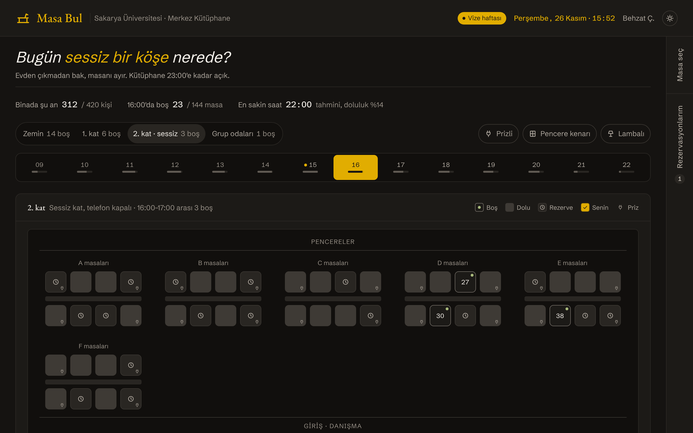

# Sonuçlarımız

> Bitirince forkunuza push edin ve fork linkinizi forma girin: **https://forms.gle/WTen8QPpZWA5A7DD7**

**Grup:** Ayberk, Rana · Brief 3: Masa Bul

| | Tur 1: Ham prompt | Tur 3: Skill + eleştiri |
| --- | --- | --- |
| Ekran görüntüsü |  |  |
| Koyu tema | — (Tur 1'de yok) |  |
| Puan (20) | 5 | 18 |

**En büyük fark neydi?** Tur 1 her yerde aynı görünen bir "AI uygulaması"ydı: mor gradient, emoji ikonlar, her masa ayrı renkli bir kart. Tur 3'te persona (Behzat Ç., vize haftası) ve kararlarımız (hardal, sıcak tonlar, Wikipedia gibi serif başlık) devreye girince sinema koltuğu gibi okunan sakin bir kat planı çıktı; boş masa tek bakışta görünüyor.

**Skill'e eklediğimiz kurallar:**

1. Hardal (`#E1AD01`) açık temada yazı rengi olmaz; dolgu olarak kullanılır, üstüne koyu yazı gelir.
2. Ekranın asıl işi kaydırmadan görünür; kendini açıklayan kontrollere etiket ve gereksiz stat kutucukları koyma.

**Bir dahaki sefere ilk yapacağımız şey:** Koda geçmeden önce DESIGN.md'yi (persona, ton, renk) doldurmak ve vurgu rengini iki temada kontrast için test etmek.
